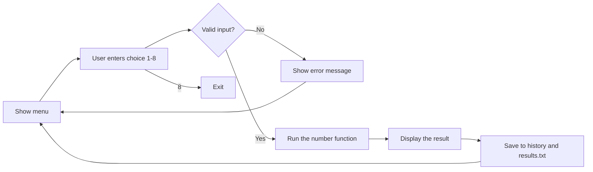

<div align="center">

# 🔢 Number Utility Toolkit

**A menu-driven Python program with small, handy tools for exploring numbers.**


*Project 8 · Python Programming Course Project*

</div>

---

## 📖 About the Project

**Number Utility Toolkit** brings common number checks and calculations together in one simple console menu. The user picks an option, enters a whole number (or two), and the program shows the result immediately. Every calculation is also saved in a text file, so nothing is lost after the program is closed.

The whole program lives in a single file, `num_toolkit.py`. Each tool is written as its own function, and the menu simply calls the right one. Invalid input such as letters does not crash the program: a short message is shown and the menu appears again.

---

## ✨ Features

| # | Menu option | What it does |
|---|-------------|--------------|
| 1 | **Check Prime, Palindrome, Armstrong, Perfect** | Tests one number for all four properties and returns the answers as a tuple |
| 2 | **Sum, Count and Reverse of Digits** | Gives the digit sum, the number of digits and the reversed number |
| 3 | **Fibonacci Series and Factorial** | Prints the first *n* Fibonacci numbers and the factorial of *n* |
| 4 | **GCD and LCM** | Finds the GCD and LCM of two numbers |
| 5 | **Prime Numbers up to N** | Lists all primes from 2 up to a chosen limit |
| 6 | **Multiplication Tables** | Prints tables (1 to 10) for every number in a chosen range |
| 7 | **View Session Data** | Shows the primes found, the number of runs and the full history of this session |
| 8 | **Exit** | Closes the program |

Every result from options 1 to 6 is saved automatically (see [Results file](#-results-file)).

---

## 🧠 Python Concepts Used

| Concept | Where it appears |
|---------|------------------|
| **Functions** | Every tool is a separate function (`is_prime`, `gcd`, `fib_series`, ...) |
| **Recursion** | `factorial()`, `fib()` and `gcd()` call themselves until a base case is reached |
| **Nested loops** | `print_tables()` (outer loop over numbers, inner loop over 1 to 10), and the prime search, where a loop calls `is_prime()` which has its own loop |
| **Lists** | `primes` and `history` store results during a run; `fib_series()` builds a list |
| **Tuples** | Functions return several values together, e.g. `digit_ops()` returns `(sum, count, reverse)` |
| **Strings and slicing** | `str(n)` splits digits; `s[::-1]` reverses text for the palindrome check |
| **Operators** | `%`, `//`, `**` and `*` handle divisors, digits, Armstrong sums and LCM |
| **Conditions and loops** | A `while` loop keeps the menu running; `if / elif / else` selects the option |
| **File handling** | Results are appended to `results.txt` |
| **Exception handling** | `try / except` catches invalid numbers and division by zero |

---

## 🔄 How It Works



The menu repeats until the user selects **8 (Exit)**.

---

## 🧩 Functions at a Glance

| Function | Purpose |
|----------|---------|
| `is_prime(n)` | Returns `True` if `n` has no divisor between 2 and `n - 1` |
| `is_palindrome(n)` | Compares the number's text with its reverse |
| `is_armstrong(n)` | Checks if the sum of each digit raised to the number of digits equals `n` |
| `is_perfect(n)` | Checks if `n` equals the sum of its proper divisors |
| `digit_ops(n)` | Returns `(digit sum, digit count, reversed number)` |
| `factorial(n)` | Recursive factorial |
| `fib(n)` | Recursive *n*-th Fibonacci number |
| `fib_series(terms)` | Builds the Fibonacci series as a list |
| `gcd(a, b)` | Recursive Euclidean GCD (LCM is found as `a * b // gcd`) |
| `primes_upto(n)` | Returns all primes up to `n` and remembers them for the session |
| `print_tables(start, end)` | Prints multiplication tables using nested loops |
| `save(operation, inp, result)` | Adds a line to the session history and appends it to `results.txt` |

---

## 🚀 Getting Started

### Requirements
- Python 3.x installed on your computer. No extra libraries are needed.

### Run the program

1. Download or clone this project and open the folder in a terminal.
2. Run:

```bash
python num_toolkit.py
```

On some systems use `py num_toolkit.py` or `python3 num_toolkit.py` instead.

3. Type a number from **1 to 8** and follow the prompts.

---

## 🖥️ Sample Run

**Option 1: number checks**

```text
--- MAIN MENU ---
1. Check Prime, Palindrome, Armstrong, Perfect
2. Sum, Count and Reverse of Digits
3. Fibonacci Series and Factorial
4. GCD and LCM
5. Prime Numbers up to N
6. Multiplication Tables
7. View Session Data
8. Exit

Enter your choice (1-8): 1
Enter a positive integer: 45
Prime, Palindrome, Armstrong, Perfect: (False, False, False, False)
```

**Option 2: digit operations**

```text
Enter your choice (1-8): 2
Enter a positive integer: 12
Sum, Count, Reverse: (3, 2, 21)
```

**Option 3: Fibonacci and factorial**

```text
Enter your choice (1-8): 3
Enter a non-negative integer: 5
Fibonacci Series: [0, 1, 1, 2, 3]
Factorial: 120
```

---

## 💾 Results File

Each calculation is appended to **`results.txt`** in the same folder, one line per calculation, in this format:

```text
Operation | Input: <input> | Result: <result>
```

Example:

```text
Number Check | Input: 45 | Result: (False, False, False, False)
Digit Operations | Input: 12 | Result: (3, 2, 21)
Fibonacci and Factorial | Input: 5 | Result: ([0, 1, 1, 2, 3], 120)
```

- The file can be opened in any text editor.
- **Option 7** shows the primes found, the total runs and the history of the **current session** only. The session history starts empty on every run, while `results.txt` keeps growing.

---

## 🛡️ Error Handling

| Situation | What the program does |
|-----------|-----------------------|
| Letters or symbols instead of a number | Shows `Please enter a valid number.` |
| Menu choice outside 1 to 8 | Shows `Invalid choice! Select 1 to 8.` |
| Negative number for option 3 | Shows `Number must not be negative.` |
| GCD is 0 (both numbers are 0) | Shows `GCD is 0, so LCM cannot be found.` |

After any message, the menu is shown again, so the program keeps running.

---

## 📁 Project Structure

```text
Number-Utility-Toolkit/
├── num_toolkit.py   # the complete program
├── results.txt      # created automatically after the first calculation
└── README.md        # this file
```

---

## ⚠️ Current Limitations

- Works with **whole numbers only** (no decimals).
- The prime check and the recursive Fibonacci are simple, so **very large numbers can be slow**. Extremely large inputs for factorial can also reach Python's recursion limit.
- The session history is not reloaded from `results.txt` on the next run.
- There is no option to clear or export the results file.

## 🔮 Future Improvements

- Support for decimal numbers in selected tools
- A clear-history option for `results.txt`
- Faster prime checking (testing divisors only up to the square root)
- Loading earlier results from the file when the program starts

---

## 🧾 Code Walkthrough

The program in `num_toolkit.py` is organised in four simple parts:

1. **Session data**: two lists, `primes` (prime numbers found) and `history` (results of this run).
2. **Tool functions**: `is_prime`, `is_palindrome`, `is_armstrong`, `is_perfect`, `digit_ops`, `factorial`, `fib`, `gcd`, `fib_series`, `primes_upto` and `print_tables`.
3. **`save()`**: adds a line to `history` and appends it to `results.txt`.
4. **Main program**: a `while True` loop prints the menu, reads the choice, runs the matching option inside `try / except`, and stops on option 8.

---

## 💻 Full Source Code

<details>
<summary><b>Click to view <code>num_toolkit.py</code></b></summary>

```python
# PROJECT 8: NUMBER UTILITY TOOLKIT
# Group 8: Rajesh Chaurasiya, Manas Dubey, Sweta, Pavan Kumar

# Session data
primes = []
history = []


# Check prime
def is_prime(n):
    if n < 2:
        return False
    for i in range(2, n):
        if n % i == 0:
            return False
    return True


# Check palindrome
def is_palindrome(n):
    s = str(n)
    return s == s[::-1]


# Check Armstrong
def is_armstrong(n):
    s = str(n)
    total = 0
    for d in s:
        total = total + int(d) ** len(s)
    return total == n


# Check perfect number
def is_perfect(n):
    if n < 1:
        return False
    total = 0
    for i in range(1, n):
        if n % i == 0:
            total = total + i
    return total == n


# Sum, count and reverse of digits
def digit_ops(n):
    total = 0
    count = 0
    rev = 0
    while n > 0:
        d = n % 10
        total = total + d
        count = count + 1
        rev = rev * 10 + d
        n = n // 10
    return total, count, rev


# Factorial (recursion)
def factorial(n):
    if n == 0 or n == 1:
        return 1
    return n * factorial(n - 1)


# Fibonacci number (recursion)
def fib(n):
    if n == 0:
        return 0
    if n == 1:
        return 1
    return fib(n - 1) + fib(n - 2)


# GCD (recursion)
def gcd(a, b):
    if b == 0:
        return a
    return gcd(b, a % b)


# Fibonacci series
def fib_series(terms):
    series = []
    for i in range(terms):
        series.append(fib(i))
    return series


# Prime numbers up to N
def primes_upto(n):
    result = []
    for i in range(2, n + 1):
        if is_prime(i):
            result.append(i)
            if i not in primes:
                primes.append(i)
    return result


# Multiplication tables
def print_tables(start, end):
    for num in range(start, end + 1):
        for i in range(1, 11):
            print(num, "x", i, "=", num * i)
        print("--------------------")


# Save result in file
def save(operation, inp, result):
    text = operation + " | Input: " + str(inp) + " | Result: " + str(result)
    history.append(text)
    f = open("results.txt", "a")
    f.write(text + "\n")
    f.close()


# Main program
print("PROJECT 8: NUMBER UTILITY TOOLKIT")
print("Group 8: Rajesh Chaurasiya, Manas Dubey, Sweta, Pavan Kumar")

while True:
    # Menu
    print("\n--- MAIN MENU ---")
    print("1. Check Prime, Palindrome, Armstrong, Perfect")
    print("2. Sum, Count and Reverse of Digits")
    print("3. Fibonacci Series and Factorial")
    print("4. GCD and LCM")
    print("5. Prime Numbers up to N")
    print("6. Multiplication Tables")
    print("7. View Session Data")
    print("8. Exit")

    choice = input("Enter your choice (1-8): ")

    try:
        # Option 1: Number checks
        if choice == "1":
            n = int(input("Enter a positive integer: "))
            p = is_prime(n)
            result = (p, is_palindrome(n), is_armstrong(n), is_perfect(n))
            if p and n not in primes:
                primes.append(n)
            print("Prime, Palindrome, Armstrong, Perfect:", result)
            save("Number Check", n, result)

        # Option 2: Digit operations
        elif choice == "2":
            n = int(input("Enter a positive integer: "))
            result = digit_ops(n)
            print("Sum, Count, Reverse:", result)
            save("Digit Operations", n, result)

        # Option 3: Fibonacci and factorial
        elif choice == "3":
            n = int(input("Enter a non-negative integer: "))
            if n < 0:
                print("Number must not be negative.")
            else:
                series = fib_series(n)
                fact = factorial(n)
                print("Fibonacci Series:", series)
                print("Factorial:", fact)
                save("Fibonacci and Factorial", n, (series, fact))

        # Option 4: GCD and LCM
        elif choice == "4":
            a = int(input("Enter first number: "))
            b = int(input("Enter second number: "))
            g = gcd(a, b)
            lcm = a * b // g
            print("GCD:", g)
            print("LCM:", lcm)
            save("GCD and LCM", (a, b), (g, lcm))

        # Option 5: Primes up to N
        elif choice == "5":
            n = int(input("Enter N: "))
            result = primes_upto(n)
            print("Prime Numbers:", result)
            save("Prime Numbers", n, result)

        # Option 6: Multiplication tables
        elif choice == "6":
            start = int(input("Enter starting number: "))
            end = int(input("Enter ending number: "))
            print_tables(start, end)
            save("Multiplication Tables", (start, end), "Done")

        # Option 7: Session data
        elif choice == "7":
            print("Primes Found:", primes)
            print("Total Runs:", len(history))
            for h in history:
                print(h)

        # Option 8: Exit
        elif choice == "8":
            print("All results are saved in results.txt")
            print("Goodbye!")
            break

        else:
            print("Invalid choice! Select 1 to 8.")

    # Error handling
    except ValueError:
        print("Please enter a valid number.")
    except ZeroDivisionError:
        print("GCD is 0, so LCM cannot be found.")
```

</details>

---

## 👥 Team

**Group 8**

| Name |
|------|
| Rajesh Chaurasiya |
| Manas Dubey |
| Sweta Gupta |
| Pavan Kumar |

**Faculty Coordinator:** Ajay Sonkar

---

<div align="center">

Made with 🐍 Python by Group 8

</div>
